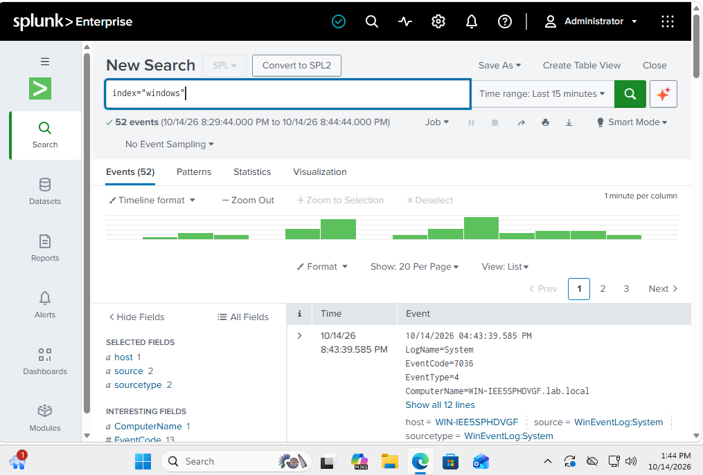
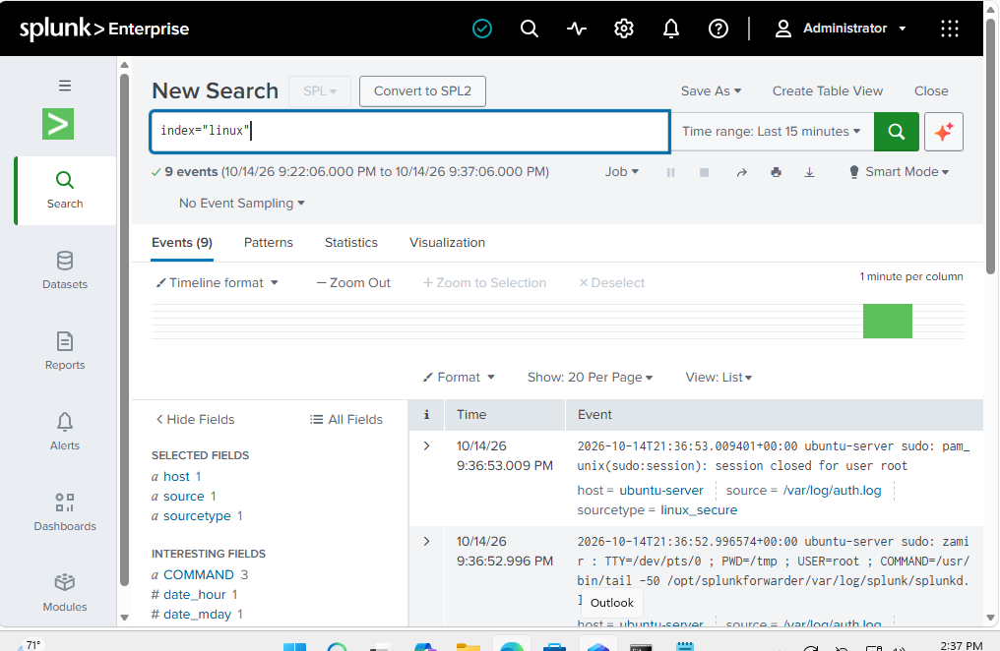
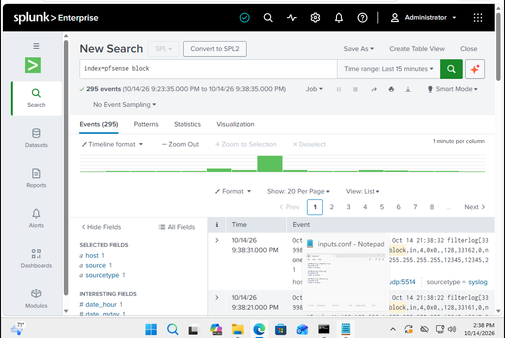

# Centralized Logging with Splunk

## Overview

Splunk is being used as the main place to collect logs from the different systems in the lab. Instead of checking pfSense, Windows, and Ubuntu separately, I can search their activity from one server.

The Splunk server is located on 'SECURITY-LAN' at '192.168.30.20'.

## Receiving Logs

I set Splunk to listen on TCP port '9997' for Universal Forwarder traffic.

Windows Server 2025, Windows 11, and Ubuntu Server all use this port to send their logs to Splunk.

pfSense is handled a little differently. Its firewall and system logs are sent directly to Splunk through syslog on UDP port '5514'.

To keep everything separated, I created three indexes:

- 'pfsense'
- 'windows'
- 'linux'

## Windows Event Logs

I installed the Splunk Universal Forwarder on both Windows Server 2025 and the Windows 11 domain client.

The forwarders collect Application, System, and Security logs and send them to the 'windows' index.

A search of the index showed events coming from both Windows machines.

## Ubuntu Logs

Ubuntu Server also uses the Universal Forwarder.

I set it to monitor Linux authentication and system logs from files such as '/var/log/auth.log'. These events are stored in the 'linux' index.

Searching the index showed authentication activity coming from 'ubuntu-server'.

## pfSense Logs

pfSense sends firewall events straight to the Splunk server over UDP port '5514'.

These logs are stored in the 'pfsense' index, which makes it easy to look through allowed and blocked network traffic without mixing it with operating system logs.

With all three indexes working, I now have pfSense, Windows, and Linux activity coming into the same Splunk server. The next step was using those logs to look for failed logins, blocked connections, and traffic generated from Kali Linux.
