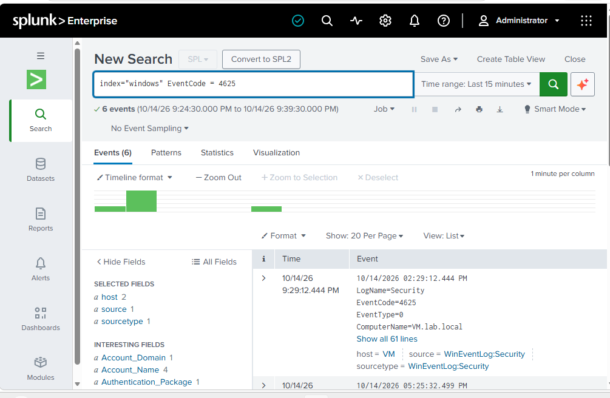
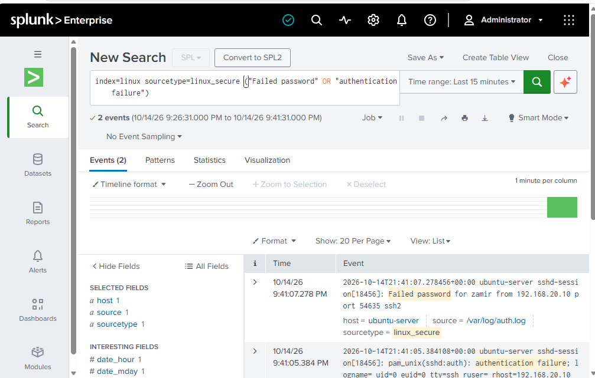
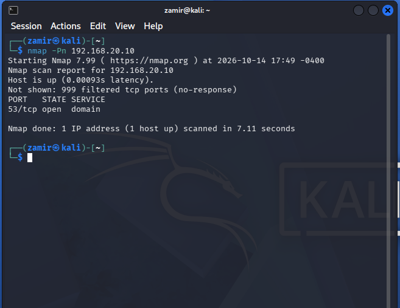
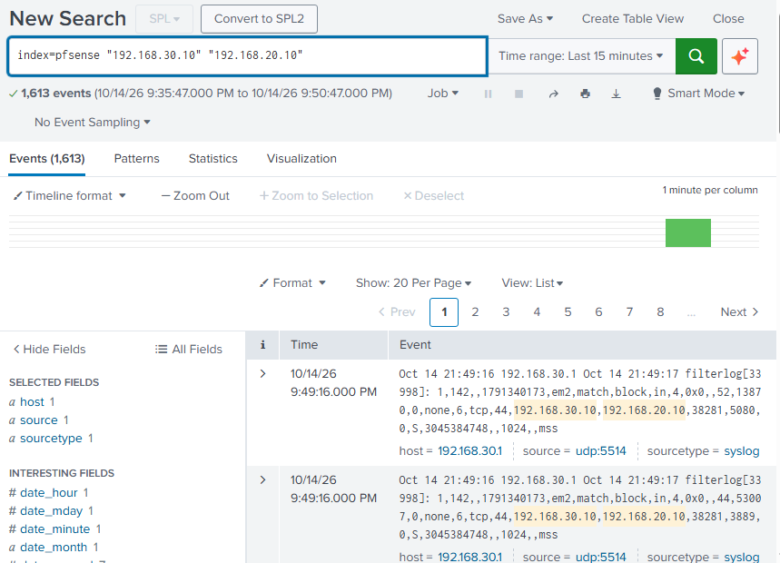
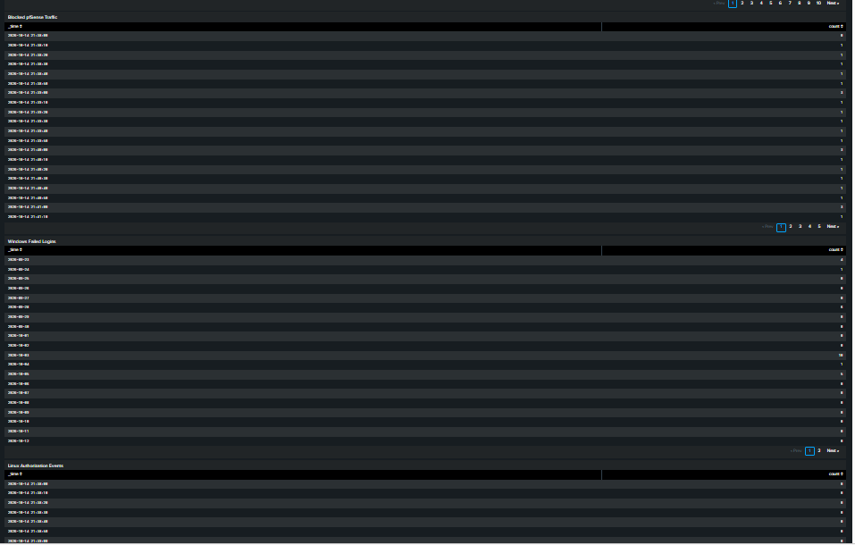

# Security Monitoring

## Overview

Once logs from pfSense, Windows, and Ubuntu were coming into Splunk, I used the data to look at actual activity happening across the lab.

I focused on failed login attempts, firewall blocks, and traffic generated from Kali Linux. I also built a small dashboard so the main events could be viewed in one place.

## Windows Failed Logins

Windows Security logs are stored in the 'windows' index.

I searched for Event ID '4625', which represents failed Windows login attempts. Splunk was able to show the failed authentication events along with information about where they came from.

This gave me a simple way to find failed login activity without checking Event Viewer on each Windows system individually.

## Linux Authentication Activity

Ubuntu authentication logs are stored in the 'linux' index.

I searched the 'linux_secure' sourcetype for failed password and authentication events. This showed login activity recorded in '/var/log/auth.log' from 'ubuntu-server'.

Having these logs in Splunk makes it easier to compare authentication activity between Windows and Linux systems from the same interface.

## Kali Network Test

I used Kali Linux on 'SECURITY-LAN' to generate network activity against Windows Server 2025 at '192.168.20.10'.

From Kali, I ran an Nmap scan against the server.

The firewall rules between 'SECURITY-LAN' and 'SERVER-LAN' blocked the unauthorized traffic.

I then searched Splunk for traffic between Kali at '192.168.30.10' and Windows Server at '192.168.20.10'.

The scan generated multiple blocked firewall events that appeared in the 'pfsense' index.

This let me follow the activity from the system generating the traffic, through the pfSense firewall, and into Splunk for review.

## Security Monitoring Dashboard

I created a dashboard to keep some of the main security events visible without having to run each search manually.

The dashboard includes:

- Blocked pfSense Traffic
- Windows Failed Logins
- Linux Authentication Events

The dashboard gives me a quick view of firewall and authentication activity across the lab and brings together logs from different systems in one place.
